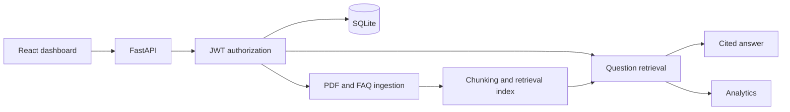

# BizMind AI

**Multi-tenant document intelligence and customer-support platform · portfolio edition**

[](https://github.com/nisa3131/BizMind-AI/actions/workflows/backend.yml)
[](https://github.com/nisa3131/BizMind-AI/actions/workflows/frontend.yml)

## Overview

BizMind AI turns business PDFs and text FAQs into a searchable support knowledge base. Owners manage their own documents and ask questions with source references. Local semantic retrieval uses ChromaDB; hosted generation is optional. A lightweight lexical mode supports resource-constrained demonstrations.

## Capabilities

| Module | Implementation |
|---|---|
| Identity | JWT authentication and Argon2 password hashing |
| Knowledge base | PDF / UTF-8 FAQ ingestion, overlapping chunks |
| Retrieval | Tenant-filtered ChromaDB semantic search or lightweight lexical search |
| Answers | Cited excerpts; optional OpenAI generation with fallback |
| Analytics | Tenant-scoped request counts and latency |
| Delivery | React + TypeScript, FastAPI, Docker Compose, GitHub Actions |

## Architecture



## Repository layout

```text
backend/app/       API, authentication, storage, retrieval, answer generation
backend/tests/     Health, authorization and tenant-boundary tests
frontend/src/      React dashboard
examples/          Synthetic demo FAQ
docs/              Architecture and interview guide
.github/workflows/ Continuous integration
docker-compose.yml Local service orchestration
```

## Local quick start (Windows)

Requires Git and Docker Desktop (WSL 2).

```powershell
git clone https://github.com/nisa3131/BizMind-AI.git
cd BizMind-AI
$secret = [guid]::NewGuid().ToString("N") + [guid]::NewGuid().ToString("N")
if (!(Test-Path .env)) { "JWT_SECRET=$secret" | Set-Content -Encoding ascii .env }
docker compose up --build -d
```

- Dashboard: http://localhost:3000
- API documentation: http://localhost:8000/docs
- Health: http://localhost:8000/api/v1/health

Upload [the example FAQ](examples/demo-faq.txt), ask about its return policy, and refresh analytics.

## API reference

| Method | Endpoint | Access |
|---|---|---|
| GET | /api/v1/health | Public |
| POST | /api/v1/auth/signup | Registration |
| POST | /api/v1/auth/login | Public |
| GET, POST | /api/v1/documents | Bearer JWT |
| POST | /api/v1/chat | Bearer JWT |
| GET | /api/v1/analytics | Bearer JWT |

## Configuration

| Variable | Purpose |
|---|---|
| JWT_SECRET | Required server-side authentication secret, at least 32 characters |
| RAG_BACKEND | lexical for lightweight demos; default semantic retrieval |
| BIZMIND_INVITE_CODE | Optional restriction on new signups |
| MAX_UPLOAD_BYTES | Configurable upload size limit |
| OPENAI_API_KEY / OPENAI_MODEL | Optional hosted generation; no paid API is required for local excerpts |

Never commit credentials. Hosted generation transmits selected excerpts and questions to the provider; use only authorized data.

## Quality and security

Run backend tests with python -m pytest from backend after installing requirements, pytest and httpx. Run npm install and npm run build in frontend. CI verifies backend tests and TypeScript builds. Integration tests exercise tenant isolation using mocked embeddings. This is not a comprehensive security audit.

## Deployment

Local Docker Compose is the reference deployment. See [free cloud demo instructions](docs/FREE_DEPLOYMENT.md) for the separate single-container build. The free demo uses lexical retrieval and temporary storage, not full semantic RAG or a persistent production database.

## Project boundaries

Portfolio prototype. Citation identifiers are not proof of entailment. No OCR, production SLA, comprehensive rate limiting or security certification is claimed. Do not upload confidential data to a public demo.

## Interview resources

[Architecture and interview walkthrough](docs/INTERVIEW_GUIDE.md) · [Sample FAQ](examples/demo-faq.txt)

## Render cloud demo configuration

[Render deployment, environment variables, health checks and live demo verification](docs/FREE_DEPLOYMENT.md). The single-container Docker build is separate from the local Docker Compose setup. Keep all credentials private.
