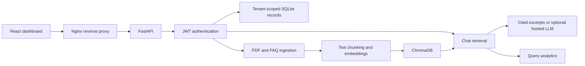

# Interview and demo guide

## Architecture

## Two-minute demo
1. Explain the business problem: support teams repeatedly answer questions from policy documents.
2. Sign into the local dashboard at http://localhost:3000.
3. Upload the synthetic sample FAQ at examples/demo-faq.txt.
4. Ask: What is the return policy? Show the cited source.
5. Refresh analytics and show query count and latency.
6. Explain tenant filtering, JWT authentication and Docker. Clarify that default answering is extractive and hosted generation is optional and not independently verified.

## Interview questions
- Why RAG rather than fine-tuning? Retrieval can update the knowledge base without retraining and can attach source references.
- Why chunking? It makes retrieval more focused and keeps context manageable. Overlap can preserve information near boundaries.
- How is tenant isolation enforced? The API derives tenant identity from the verified token and scopes database and vector queries; the browser cannot choose another tenant.
- What does a citation guarantee? It identifies retrieved material, not proof that a generated statement is supported.
- What is the role of Docker? Reproducible service setup and persistent local volumes.
- How is it tested? API integration tests use mocked retrieval and test tenant separation; frontend CI checks TypeScript build. These are not a full security audit.
- What would you improve for production? Rate limits, HTTPS, PostgreSQL migrations, authorization review, embedding and answer quality evaluation, monitoring and backups.

## CV description
BizMind AI — AI-assisted multi-tenant customer support prototype | FastAPI, ChromaDB, React, SQLite, Docker. Implemented PDF/FAQ ingestion, JWT-authenticated tenant-scoped retrieval, cited responses and query analytics in an AI-assisted development workflow.

## Recording
Use a local screen recorder with synthetic data. Do not display credentials. Record the demo above; no paid hosting is needed.
